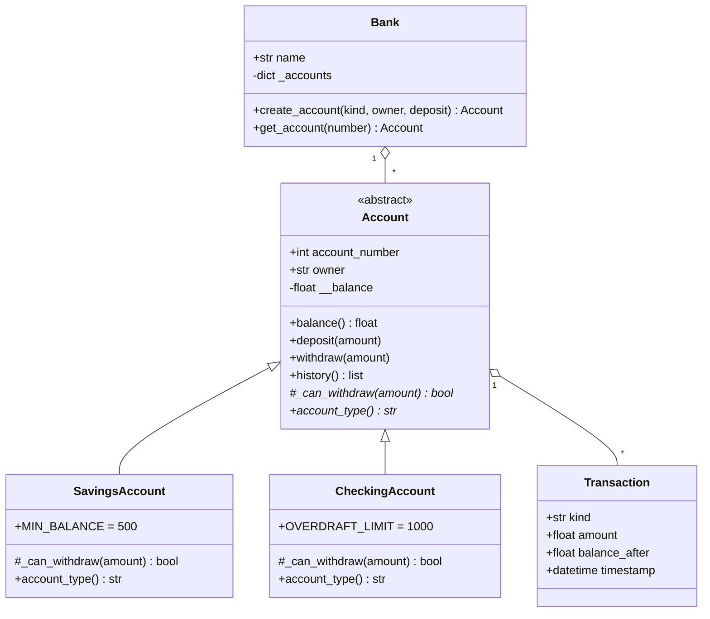

# Python Banking System (OOP)

A command-line banking application built with Object-Oriented Python.

## Features
- Create Savings and Checking accounts
- Deposit and withdraw money
- View balance
- Full transaction history with timestamps

## How to run
```bash
python banking.py
```

## OOP Concepts Used
| Concept | Where |
|---|---|
| Classes & objects | `Account`, `Transaction`, `Bank` |
| Constructors | `__init__` in every class |
| Encapsulation | private `__balance`, exposed via read-only `balance` property |
| Inheritance | `SavingsAccount` and `CheckingAccount` extend `Account` |
| Polymorphism | each subclass overrides `_can_withdraw()` and `account_type()` |
| Abstraction | `Account` is an abstract base class (`ABC`) |

## Business Rules
- Savings: balance must stay at or above 500.
- Checking: overdraft allowed up to 1000.

## Class Diagram


## Design Notes
- `Bank` manages accounts; `Account` manages its own balance and history (single responsibility).
- Withdrawal rules live in subclasses, so adding a new account type needs no change to existing code.
- Invalid operations raise clear exceptions (`ValueError`, `InsufficientFundsError`).
